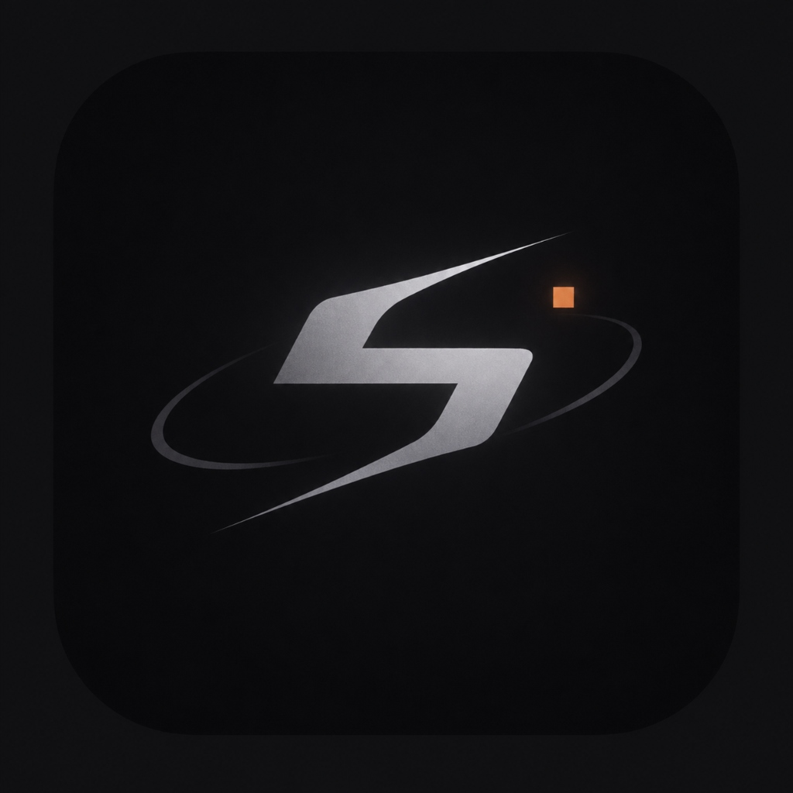

<div align="center">



# SPECTRE
### Виртуализация игровой активности и прокачка значков Discord
*Автор: [an1zy](https://github.com/an1zy)*

<p align="center">
  <a href="README.md">English</a> · <b>Русский</b>
</p>

<p align="center">
  <a href="https://python.org"></a>
  <a href="https://microsoft.com"></a>
  <a href="LICENSE"></a>
  <a href="https://discord.com"></a>
</p>

```
  ███████╗██████╗ ███████╗ ██████╗████████╗██████╗ ███████╗
  ██╔════╝██╔══██╗██╔════╝██╔════╝╚══██╔══╝██╔══██╗██╔════╝
  ███████╗██████╔╝█████╗  ██║        ██║   ██████╔╝█████╗  
  ╚════██║██╔═══╝ ██╔══╝  ██║        ██║   ██╔══██╗██╔══╝  
  ███████║██║     ███████╗╚██████╗   ██║   ██║  ██║███████╗
  ╚══════╝╚═╝     ╚══════╝ ╚═════╝   ╚═╝   ╚═╝  ╚═╝╚══════╝
```

<p align="center">
  <a href="https://github.com/an1zy/spectre-discord/releases/latest">
    
  </a>
</p>

<p align="center">
  <b><a href="https://github.com/an1zy/spectre-discord/releases/latest">Перейти к странице релизов (.exe)</a></b><br/>
  <i>Готовая сборка. Терминал и Python не требуются: скачал и запустил.</i>
</p>

</div>

---

## Как это работает

Приложение Discord сканирует запущенные процессы в Windows через стандартный системный API (`EnumProcesses` и `GetWindowTextW`) и сверяет их со своей официальной базой распознаваемых игр (`https://discord.com/api/v9/applications/detectable`).

```
┌────────────────────────┐         ┌────────────────────────┐
│     SPECTRE Engine     │         │     Discord Client     │
└───────────┬────────────┘         └───────────┬────────────┘
            │                                  │
    Запуск микро-пустышки                      │
    (WS_EX_TOOLWINDOW)                         │
            │                                  │
            ▼                                  │
┌────────────────────────┐                     │
│  Целевой Win32 процесс │ ◄─────── Сканирует список процессов
│   (например, cs2.exe)  │          и заголовки окон
└────────────────────────┘                     │
                                               ▼
                                   ┌────────────────────────┐
                                   │  Отправляет телеметрию │
                                   │  на серверы Discord    │
                                   └────────────────────────┘
```

1. SPECTRE создает легкую нативную микро-пустышку (`dummy.exe`, 4 КБ) с системными флагами `WS_EX_TOOLWINDOW` и `WS_EX_NOACTIVATE`.
2. Windows видит полноценный процесс игры, но окно создается за границами экрана (-10000, -10000) **без значков на панели задач, без перехвата курсора и с 0% нагрузки на процессор**.
3. Discord считывает имя процесса и активность без использования токенов, читов или инъекций в память.

---

## Варианты запуска

### Вариант 1: Готовый файл (простой запуск)

1. Откройте приложение **Discord на компьютере**.
2. Скачайте файл **[`spectre_windows_x64.exe`](https://github.com/an1zy/spectre-discord/releases/latest)** из раздела релизов.
3. Запустите его и выберите нужный пункт в меню.

*(Если Windows покажет предупреждение SmartScreen — нажмите «Подробнее» → «Выполнить в любом случае». У бесплатных инди-проектов нет платного сертификата Microsoft).*

### Вариант 2: Запуск через консоль

Если удобнее запускать через терминал или хотите сами менять исходный код:

```bash
git clone https://github.com/an1zy/spectre-discord.git
cd spectre-discord

pip install -r requirements.txt
python main.py
```
*(Или дважды кликните по `start.bat`)*

Чтобы собрать свой автономный exe-файл:
```bash
pip install pyinstaller
python build_exe.py
```

---

## Что умеет программа

- **Значок «Универсал»:** перебирает официальную базу Discord (10 400+ игр) пачками по 8 игр на 15 секунд. Прокачивает значок вплоть до Мифического уровня (10 000 игр).
- **Значок «Время в играх»:** запускает до 20 легких фоновых процессов параллельно. Часы умножаются до 20 раз (1 час работы = 20 часов в профиле).
- **Имитация игрока (Humanizer):** по очереди запускает выбранные игры и делает небольшие перерывы со статусом «отошел», будто за компьютером сидит живой человек.
- **Свои названия игр (Forge):** позволяет выставить в статус любую игру, даже еще не вышедшую (GTA VI, Half-Life 3 или любое свое название).
- **Безопасность:** не требует логина или токена, ничего не внедряет в память Discord и не трогает файлы клиента. Discord видит обычные фоновые процессы Windows через стандартные системные вызовы.

---

## Пункты меню

| Клавиша | Режим | Описание |
|:---:|:---|:---|
| `[1]` | **Универсал (Variety)** | Перебор 10 400+ игр пачками (по 8 штук на 15 секунд) |
| `[2]` | **Множитель часов** | До 20 процессов одновременно (умножение времени до 20 раз) |
| `[3]` | **Имитация игрока** | Естественные сессии со сменой игр и перерывами |
| `[4]` | **Кузница игр** | Запуск кастомных и редких тайтлов в статус |
| `[5]` | **Одиночный запуск** | Поиск и запуск любой одной игры из базы |
| `[6]` | **Статистика** | Просмотр прогресса и сброс истории |

---

## Частые вопросы

#### Почему значок обновился не сразу?
Приложение Discord на ПК фиксирует игру сразу, но сервера Discord пересчитывают значки в профиле раз в 2–24 часа, чтобы не перегружать базы данных. Если в профиле Discord загорелось «В игре: ...», значит сессия уже засчитана.

#### Могут ли за это забанить?
Нет. Программа не перехватывает трафик и не лезет во внутренние файлы Discord. С точки зрения Discord это выглядит ровно так же, как если бы вы запустили обычную игру на Windows.

---

## Лицензия

Проект распространяется по лицензии [MIT](LICENSE).
